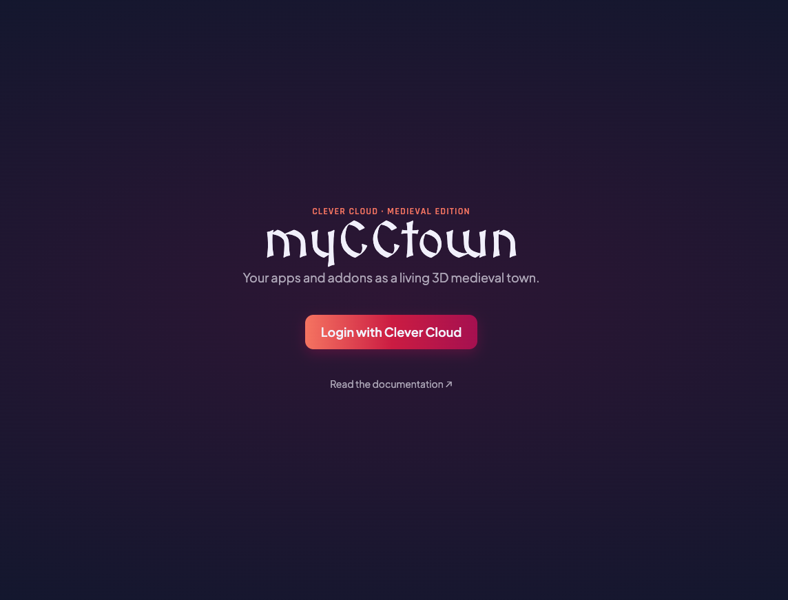
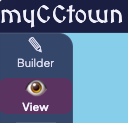
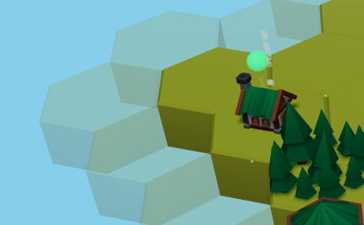
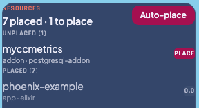
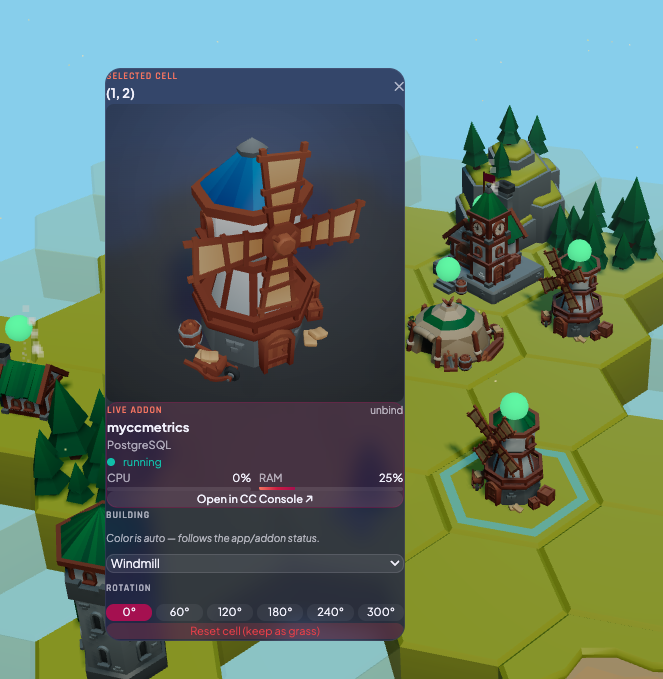
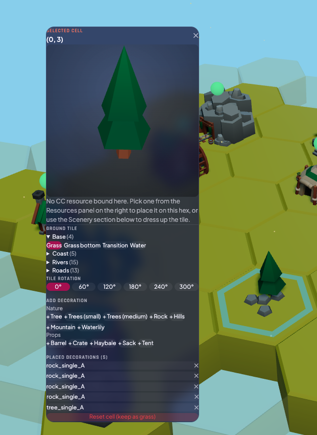
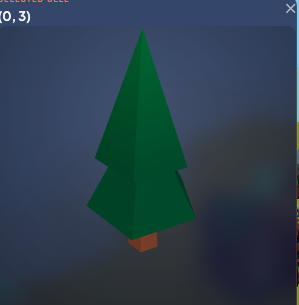
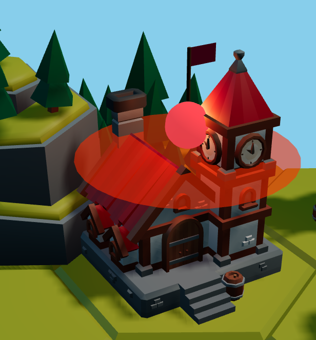
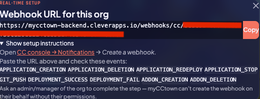

# myCCtown — User Guide

Welcome! myCCtown turns your Clever Cloud organisations into a living
medieval hex-city. Every app and addon you drop on the map becomes a
building whose colour, orientation and surroundings you control — and
whose status animates live as Clever Cloud deploys or restarts it.

This guide is for anyone with a Clever Cloud account who wants a
richer, more visual way to keep an eye on their organisations. No
code, no setup on your side — just log in and build.

## 1. Login

1. Open <https://mycctown.cleverapps.io>.
2. Click **Login with Clever Cloud**.
3. On the Clever Cloud authorisation page, click **Allow** to grant
   myCCtown read access to your orgs, apps and addons.
4. You land back on myCCtown. The first time, you'll see an empty
   hex field (a small patch of grass) and the top bar with:
   - Org selector (your orgs appear in the dropdown).
   - **⚡ Realtime setup** button (see section 5).
   - **🔇 Music** toggle for the medieval ambient soundtrack — click
     it to start playback. Your preference is remembered between
     visits; if you turn it on, it'll resume automatically next time
     (after your first click anywhere on the page, due to browser
     autoplay rules).
   - Live / offline indicator.

## 2. Picking an organisation

Click the org selector in the top bar and pick one. myCCtown loads
(or creates) the map for that org and starts showing live updates —
whenever an app deploys, crashes or restarts on Clever Cloud, the
matching building reacts on screen within a second or two.

Each org has its **own independent map**. Switching orgs swaps the
scene.

## 3. Builder mode vs View mode

The **mode toggle** lives in the left sidebar:

- **Builder** (default): edit the map — place buildings, change
  tiles, rotate, add decorations, expand the grid.
- **View**: read-only — full-scene cinematic with the realtime
  inspector overlaying selected buildings. Builder panels and ghost
  controls are hidden.

### 3.1 Expanding the map (builder only)

Translucent hex slots appear around every existing cell. **Click** a
ghost slot to create a new grass tile there. Keep clicking to grow
the city outward. No limit besides your GPU.

### 3.2 Placing an app or an addon

The right-hand **Resources** panel lists all your org's apps and
addons, split into:

- **Unplaced** — not yet mapped to a hex.
- **Placed** — already on the map. Click one to zoom to its hex.

Click an entry → a building appears on the currently selected hex
(or on a free hex nearby if none is selected). **Auto-place** at the
top of the panel puts every unplaced resource on the map in one
click.

#### Which building do I get?

myCCtown picks a building automatically based on the app's
technology or the addon's provider. You can change it afterwards
from the Inspector, but the defaults are:

**Applications**

| Technology | Building |
|---|---|
| Node.js | Home (wooden roof) |
| PHP | Home (stone roof) |
| Python | Shrine |
| Ruby | Tavern |
| Java, Scala, Maven, Gradle | Blacksmith |
| Rust, Go | Watchtower |
| Docker | Castle |
| Static sites (Apache, plain static) | Market |
| Elixir, Erlang | Church |
| .NET | Town hall |
| Haskell | Workshop |
| *anything else* | Tent |

**Addons**

| Provider | Building |
|---|---|
| PostgreSQL, MySQL, MongoDB | Watermill |
| Redis | Tower |
| Elasticsearch | Tower (stone variant) |
| Jenkins | Stables |
| Cellar (S3), FS Bucket | Docks |
| Pulsar, Kafka | Lumbermill |
| Mailpace | Shipyard |
| Config Provider | Well |
| Metabase, Matomo | Town hall |
| Keycloak | Cannon tower |
| Heptapod | Workshop |
| *anything else* | Mine |

### 3.3 Inspector: the details panel

Click any cell to open the Inspector on the left. What you see
depends on whether the cell is linked to one of your apps or addons:

#### If the cell is linked to an app or addon:

- **Live panel** with the name, type, status indicator, CPU / RAM
  gauges, and an "Open in CC Console ↗" link.
- Building section (type picker only — the **colour is driven by
  live status** and can't be overridden).
- **Rotation picker** (0° / 60° / 120° / 180° / 240° / 300°).
- **Unlink** button — removes the link; the cell stays, the app
  becomes unplaced again.

#### If the cell has no resource linked (decorative):

- **Ground tile** palette grouped by Base / Coast / Rivers / Roads.
  Click a variant to swap the cell's tile. The group containing the
  current tile auto-opens.
- **Tile rotation** picker — orients rivers, roads and coasts to
  line up with neighbours.
- **Add decoration** palette — trees, rocks, props — click to stack
  them onto the hex with random positions (so the same decoration
  doesn't pile at the centre).
- **Rotation picker for the building** if one was manually placed.

### 3.4 Preview

The top of the Inspector shows a **small 3D preview** of the current
asset (building if linked, tile otherwise). Hover over any palette
button (tile, decoration) and the preview switches to that option
while you're hovering. Click to commit.

### 3.5 Reset a cell

"Reset cell" (red button at the bottom of the Inspector) clears the
building + decorations and sets the tile back to grass. The hex
stays visible so you don't get "holes" in the map.

### 3.6 Auto-save

Your changes are saved automatically about 2 seconds after you stop
editing — there's no Save button. The top bar shows *Saving…*
briefly, then *Saved*. Your city follows you across devices; nothing
is kept only in your browser.

## 4. Reading the live scene

### 4.1 Colour vocabulary

| Colour / look | Meaning |
|---|---|
| **Green** building | Running — app is deployed and healthy |
| **Blue** building | Deploying — a deployment is in progress |
| **Red** building with flames + orange glow + ground halo | Failed — the last deployment failed, or an addon is unhealthy |
| **Yellow** building | Unknown — no status yet, or myCCtown can't read one |
| **Wooden scaffolding** | Created or stopped — the app exists on Clever Cloud but isn't running |

### 4.2 Animations

- **Windmills and watermills** spin at a speed that tracks the live
  CPU of the linked app. The curve is deliberately steep in the
  upper range: 0 % CPU = barely turning, 50 % = moderate, 100 % =
  about 5× faster (clearly ripping). Helps spot CPU saturation at a
  glance from the overview camera.
- **Homes, taverns, blacksmiths, workshops, town halls** emit
  **chimney smoke** while the app is running. The smoke column
  density tracks CPU — busy app = thick plume, idle = thin wisp.
- **Mines** leak **dust** from the entrance; intensity also scales
  with CPU.
- **Blacksmiths** throw **yellow-orange sparks** with a pulsing
  orange glow at the forge, rhythmically, as if the hammer is
  beating.
- **Castles, town halls and churches** fly a **waving flag** in the
  Clever Cloud red-pink.
- **Watchtowers and towers** sweep a **rotating spotlight** from
  their top. Especially striking at night.
- **Every building** has a warm lantern glow that fades in as night
  falls — the village is never pitch black.
- **Deploying** buildings are surrounded by a yellow wooden
  **scaffold** that rotates gently.
- **Failed** buildings are a proper bonfire: yellow-to-red particles,
  pulsing orange glow, pulsing red ground halo.
- **Clouds** drift across the sky and wrap around.

### 4.3 Status Badge

A small coloured sphere floats above every live building. Match the
colour legend above. Addons get the same badge, coloured by their
healthy / unhealthy state.

### 4.4 Hover / click in View mode

In View mode, click a building → the **Floating Inspector** shows a
compact card right next to the hex with the same live data (name,
status, CPU, RAM, mini charts). Click empty space to dismiss.

### 4.5 Ambient soundtrack

The 🔇/🔊 button in the top bar toggles a small library of medieval
ambient tracks (Castle Ember, Cobblestone Noon, First Village…) that
shuffle and play one after the other while you build or watch your
city. Volume is fixed and quiet by design — it's meant to sit under
the visuals, not compete with them. Hover the button to see the
currently-playing track name. Toggle off to stop.

### 4.6 The Mayor

Your town has a mayor who keeps an eye on things. Whenever something
happens — an app finishes deploying, a deploy fails, an app or add-on is
created, stopped, or removed — he pops up bottom-left to announce the news.
Good news comes with a green trim, routine updates with orange, and trouble
with red. Each message clears itself after a few seconds (bad news lingers a
bit longer), and if several things happen at once he reports them one by one.

He also offers the occasional tip — a welcome when you first arrive, and a
heads-up if some of your apps have fallen.

The **🏛️ Mayor** button in the top bar opens his chronicle: a log of recent
announcements you may have missed. From there you can clear the log, or tick
**Mute the mayor** if you'd rather he stayed quiet.

## 5. Real-time setup (webhooks)

Without any setup, status updates come from Clever Cloud every 10
seconds or so. That's fine — just a little behind. Turning on
notification webhooks gets you **sub-second** updates.

Click the **⚡ Realtime setup** button in the top bar. A modal shows:

- A URL unique to you + this org.
- A **Copy** button.
- A link to the org's Clever Cloud Notifications page.
- Under "Show setup instructions", the list of events to tick.

Procedure:

1. Click **Copy**.
2. Click the Clever Cloud console link → *Notifications* →
   *Create webhook*.
3. Paste the URL. Check the events listed in the modal (or tick
   "all events" — myCCtown ignores the ones it doesn't use).
4. Save.
5. Trigger a deploy on one of your apps. The building flashes blue,
   then green in under 2 seconds.

### Who can set it up?

**Org admins or managers only** — Clever Cloud restricts
notification creation. If you're a developer-level member, ask your
admin. The URL is tied to **you** (the myCCtown user), so the admin
is only publishing the URL you generated.

### Lost your URL?

Open the modal again — the same URL is shown. If you need to rotate
it (e.g. you think it leaked), a myCCtown administrator can reset
it; the technical steps live in [webhooks.md](webhooks.md).

## 6. Troubleshooting

### "ws error" message in the top bar

The live-updates connection dropped, or your login session expired.
Refresh the page. If the message persists, log out and log back in.

### My org doesn't appear in the selector

1. Check <https://console.clever-cloud.com> — do you see it there?
2. If yes but myCCtown doesn't, your authorisation may be stale.
   Click **Logout** (top-right), then log in again.

### My app stays "unknown" forever

Wait 10 seconds. If it's still yellow:

1. Verify the app is visible in the Clever Cloud console (new apps
   sometimes take a minute to appear on Clever Cloud's side).
2. If it is visible there but still yellow in myCCtown, report it
   with the app name and org name.

### Building rotation doesn't match my rivers

Tiles and buildings rotate in **60° steps** (0, 60, 120, …, 300)
because the hexes are pointy-top. Rivers and roads are designed so
neighbouring tiles share an orientation — if two rivers don't line
up, one of them is rotated a step too far. Use the rotation picker
in the Inspector.

### The scene lags on my machine

- Reduce the number of hexes — scenes above ~200 cells feel
  sluggish on integrated GPUs.
- Turn off **Particles** or **Clouds** from the left sidebar.
- Switch to **View** mode for a lighter scene (fewer overlays).

## 7. FAQ

**Q: Is myCCtown free to use?**
A: Yes. Open <https://mycctown.cleverapps.io> and log in with your
Clever Cloud account.

**Q: Where is my city data stored?**
A: On myCCtown's servers (hosted on Clever Cloud). Nothing is kept
in your browser, so your city follows you across devices.

**Q: Can two users of the same org share a map?**
A: No — each user has their own map for each org. You can, however,
each set up Realtime so both of you see the same live status on
your own maps simultaneously.

**Q: Does myCCtown modify anything on my Clever Cloud account?**
A: Only if you ask it to. It reads your orgs, apps and addons, and
when you set up Realtime you (or your admin) give Clever Cloud a
webhook URL yourself. myCCtown never creates notifications on your
behalf.

**Q: Who made the medieval art?**
A: [KayKit Medieval Hexagon Pack](https://kaylousberg.com/game-assets)
by Kay Lousberg. Cute and free with attribution.

---

Questions or bug reports → open an issue in the
[myCCtown repository](https://github.com/fredericalix/mycctown).
